# Class Diagram - The Sweet Lab (Chuẩn OOP - UML)

Tài liệu này lưu trữ **Sơ đồ Class hiệu chỉnh theo chuẩn OOP (UML)** cho dự án **The Sweet Lab** (không phải sơ đồ JPA Entity/ERD).

## Các điểm hiệu chỉnh chính
- Bổ sung `Shipment` và `ShipmentStatus` cho domain **Payment & Shipment**.
- Snapshot thông tin giao hàng (`shippingRecipientName`, `shippingPhone`, `shippingAddress`) trên `Order` và thông tin sản phẩm (`productName`, `variantName`) trên `OrderItem`.
- Dùng `ProductStatus` enum thay cho `boolean status` trên `Product`.
- Bổ sung `isDefault` trên `UserAddress`, `usedCount` trên `Voucher` và các phương thức nghiệp vụ OOP trên các lớp cốt lõi.
- Giữ nguyên bản chất OOP cho các lớp không có ID riêng (`CartItem`, `WishItem`, `FlashSaleItem`, `Review`, `NutritionFacts`, `ProductImage`).

```mermaid
classDiagram
    %% ================= ENUMERATIONS =================
    class UserRole {
        <<enumeration>>
        CUSTOMER
        ADMIN
    }
    class AccountStatus {
        <<enumeration>>
        PENDING_VERIFICATION
        ACTIVE
        BLOCKED
    }
    class Gender {
        <<enumeration>>
        MALE
        FEMALE
        OTHER
    }
    class TokenType {
        <<enumeration>>
        EMAIL_VERIFICATION
        OTP
        PASSWORD_RESET
        REFRESH_TOKEN
    }
    class AddressType {
        <<enumeration>>
        HOME
        OFFICE
        OTHER
    }
    class ActivityLevel {
        <<enumeration>>
        SEDENTARY
        LIGHT
        MODERATE
        VERY_ACTIVE
        EXTRA_ACTIVE
    }
    class Allergen {
        <<enumeration>>
        MILK
        EGG
        PEANUT
        TREE_NUT
        SOY
        GLUTEN
        SESAME
        SULFITE
    }
    class ProductStatus {
        <<enumeration>>
        ACTIVE
        INACTIVE
        OUT_OF_STOCK
    }
    class OrderStatus {
        <<enumeration>>
        PENDING
        CONFIRMED
        SHIPPING
        DELIVERED
        CANCELLED
        RETURNED
    }
    class PaymentMethod {
        <<enumeration>>
        COD
        BANKING
    }
    class PaymentStatus {
        <<enumeration>>
        PENDING
        SUCCESS
        FAILED
        REFUNDED
    }
    class ShipmentStatus {
        <<enumeration>>
        PREPARING
        IN_TRANSIT
        DELIVERED
        FAILED
        RETURNED
    }
    class FlashSaleStatus {
        <<enumeration>>
        UPCOMING
        ACTIVE
        ENDED
        CANCELLED
    }
    class DiscountType {
        <<enumeration>>
        PERCENTAGE
        FIXED_AMOUNT
    }
    class ChatSessionStatus {
        <<enumeration>>
        ACTIVE
        CLOSED
    }
    class SenderType {
        <<enumeration>>
        USER
        ASSISTANT
        SYSTEM
    }

    %% ================= AUTH & USER =================
    class Account {
        -id: Long
        -email: String
        -phone: String
        -passwordHash: String
        -role: UserRole
        -status: AccountStatus
        -createdAt: LocalDateTime
        -lastLoginAt: LocalDateTime
        +verify(token: AuthToken) boolean
        +changePassword(oldPwd: String, newPwd: String) void
        +block() void
    }

    class AuthToken {
        -id: Long
        -type: TokenType
        -tokenValue: String
        -expiredAt: LocalDateTime
        -isUsed: boolean
        +isValid() boolean
        +markUsed() void
    }

    class User {
        -id: Long
        -fullName: String
        -avatarUrl: String
        -dateOfBirth: LocalDate
        -gender: Gender
        +/age: int
        +updateProfile(fullName: String, avatarUrl: String) void
    }

    class UserAddress {
        -id: Long
        -recipientName: String
        -phone: String
        -province: String
        -district: String
        -ward: String
        -detailAddress: String
        -type: AddressType
        -isDefault: boolean
        +/fullAddress: String
        +setAsDefault() void
    }

    class NutritionProfile {
        -id: Long
        -heightCm: double
        -weightKg: double
        -activityLevel: ActivityLevel
        -allergens: Set~Allergen~
        +/bmi: double
        +/tdee: double
        +/dailyCalorieTarget: int
        +/dailyProteinTarget: double
        +/dailyCarbTarget: double
        +/dailyFatTarget: double
        +/dailySugarLimit: double
        +isSafeFor(product: Product) boolean
    }

    %% ================= PRODUCT & CATALOG =================
    class Category {
        -id: Long
        -name: String
        -slug: String
        -description: String
    }

    class Brand {
        -id: Long
        -name: String
        -slug: String
        -logoUrl: String
        -country: String
    }

    class Product {
        -id: Long
        -name: String
        -slug: String
        -description: String
        -ingredients: String
        -shelfLifeDays: int
        -storageInstruction: String
        -allergens: Set~Allergen~
        -status: ProductStatus
        -createdAt: LocalDateTime
        -updatedAt: LocalDateTime
        +/thumbnailUrl: String
        +/averageRating: double
        +/reviewCount: int
        +hasAllergen(allergen: Allergen) boolean
    }

    class ProductVariant {
        -id: Long
        -sku: String
        -name: String
        -price: BigDecimal
        -originalPrice: BigDecimal
        -stockQuantity: int
        -weightGram: double
        -isActive: boolean
        +isInStock(quantity: int) boolean
        +reserveStock(quantity: int) void
        +releaseStock(quantity: int) void
    }

    class ProductImage {
        -imageUrl: String
        -displayOrder: int
        -isThumbnail: boolean
    }

    class NutritionFacts {
        -perAmountG: double
        -calories: double
        -proteinG: double
        -carbG: double
        -sugarG: double
        -fiberG: double
        -fatG: double
        -sodiumMg: double
    }

    class NutritionTag {
        -id: Long
        -name: String
        -description: String
    }

    %% ================= PROMOTION =================
    class FlashSale {
        -id: Long
        -title: String
        -startTime: LocalDateTime
        -endTime: LocalDateTime
        -status: FlashSaleStatus
        +isActiveNow() boolean
    }

    class FlashSaleItem {
        -flashSalePrice: BigDecimal
        -quantityLimit: int
        -soldQuantity: int
        -displayOrder: int
        +/discountPercent: int
        +hasRemainingQuota(qty: int) boolean
    }

    class Voucher {
        -id: Long
        -code: String
        -title: String
        -discountType: DiscountType
        -discountValue: BigDecimal
        -maxDiscountAmount: BigDecimal
        -minOrderAmount: BigDecimal
        -startDate: LocalDateTime
        -endDate: LocalDateTime
        -usageLimit: int
        -usedCount: int
        +isUsable(orderSubtotal: BigDecimal) boolean
        +calculateDiscount(orderSubtotal: BigDecimal) BigDecimal
    }

    %% ================= CART, ORDER, PAYMENT, SHIPMENT, REVIEW =================
    class Cart {
        -id: Long
        +/totalQuantity: int
        +/subtotal: BigDecimal
        +addItem(variant: ProductVariant, qty: int) void
        +updateItemQuantity(variant: ProductVariant, qty: int) void
        +removeItem(variant: ProductVariant) void
        +clear() void
    }

    class CartItem {
        -quantity: int
        +/unitPrice: BigDecimal
        +/lineTotal: BigDecimal
    }

    class WishItem {
        -addedAt: LocalDateTime
    }

    class Order {
        -id: Long
        -orderCode: String
        -status: OrderStatus
        -note: String
        -shippingRecipientName: String
        -shippingPhone: String
        -shippingAddress: String
        -shippingFee: BigDecimal
        -discountAmount: BigDecimal
        -createdAt: LocalDateTime
        -updatedAt: LocalDateTime
        +/subtotal: BigDecimal
        +/totalAmount: BigDecimal
        +applyVoucher(voucher: Voucher) void
        +confirm() void
        +cancel(reason: String) void
    }

    class OrderItem {
        -productName: String
        -variantName: String
        -unitPrice: BigDecimal
        -quantity: int
        +/lineTotal: BigDecimal
    }

    class Payment {
        -id: Long
        -transactionCode: String
        -method: PaymentMethod
        -status: PaymentStatus
        -amount: BigDecimal
        -paidAt: LocalDateTime
        +markPaid(transactionCode: String) void
        +markFailed() void
    }

    class Shipment {
        -id: Long
        -trackingCode: String
        -carrier: String
        -status: ShipmentStatus
        -estimatedDeliveryAt: LocalDateTime
        -shippedAt: LocalDateTime
        -deliveredAt: LocalDateTime
        +updateStatus(status: ShipmentStatus) void
    }

    class Review {
        -rating: int
        -comment: String
        -createdAt: LocalDateTime
        +edit(rating: int, comment: String) void
    }

    %% ================= AI CHATBOT =================
    class AiChatSession {
        -id: Long
        -status: ChatSessionStatus
        -startedAt: LocalDateTime
        -lastMessageAt: LocalDateTime
        +/messageCount: int
        +addMessage(sender: SenderType, content: String) AiChatMessage
        +close() void
    }

    class AiChatMessage {
        -id: Long
        -senderType: SenderType
        -content: String
        -createdAt: LocalDateTime
    }

    %% ================= RELATIONSHIPS =================
    Account "1" *-- "0..*" AuthToken
    Account "1" -- "1" User

    User "1" *-- "1..*" UserAddress
    User "1" *-- "0..1" NutritionProfile
    User "1" *-- "1" Cart
    User "1" *-- "0..*" WishItem
    User "1" --> "0..*" Order
    User "1" *-- "0..*" AiChatSession
    User "1" --> "0..*" Review

    Category "1" o-- "0..*" Product
    Brand "1" o-- "0..*" Product
    Product "1" *-- "1..*" ProductVariant
    Product "1" *-- "0..*" ProductImage
    Product "1" *-- "0..1" NutritionFacts
    Product "0..*" -- "0..*" NutritionTag
    Product "1" <-- "0..*" WishItem
    Product "1" <-- "0..*" Review

    Cart "1" *-- "0..*" CartItem
    CartItem "0..*" --> "1" ProductVariant

    FlashSale "1" *-- "0..*" FlashSaleItem
    FlashSaleItem "0..*" --> "1" ProductVariant

    Order "1" *-- "1..*" OrderItem
    OrderItem "0..*" --> "1" ProductVariant
    Order "1" *-- "1" Payment
    Order "1" *-- "1" Shipment
    Order "0..*" --> "0..1" Voucher
    Order "1" <-- "0..*" Review

    AiChatSession "1" *-- "0..*" AiChatMessage
```

